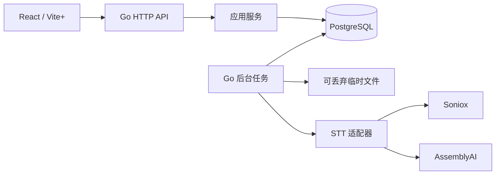

# Voices 架构

## 范围与技术栈

面向个人日常录音管理的自托管 Web 应用。前端 Vite+、React、TypeScript，组件采用 shadcn/ui + Base UI，后台 Go。
数据库仅支持 PostgreSQL，保存音频、业务数据、会话和任务。应用实例无持久数据卷，临时文件随时可丢弃。

[产品契约](feature/recording-library/README.md) · [转写契约](feature/transcription/README.md) · [人物契约](feature/people/README.md) · [初始方案](design/foundation/README.md) · [无状态存储方案](design/stateless-media/README.md)

用户通过邮箱、用户名和密码注册，可用用户名或邮箱登录；每账号拥有独立数据，首个成功注册者为系统管理员。支持多个无状态应用副本。团队共享、数据库高可用编排、实时录音和声纹自动认人不属于当前承诺。
账号模型、权限与迁移以 [账号方案](research/account-isolation/README.md) 和 [账号契约](feature/accounts/README.md) 为准。
声纹自动认人的范围尚待用户明确；当前采用录音内自动区分说话人、用户确认人物关联。

## 模块与部署

- `web/`：页面、上传进度、播放器、转写编辑和人物管理。业务数据通过 HTTP API 获取。
- `cmd/voices/`：启动入口；每个副本运行 HTTP 服务与后台任务，数据库协调任务和全局并发。
- `internal/app/recordings.go`：导入、摘要去重、录音元数据及删除协调。
- `internal/app/transcriptions.go` 与 `segments.go`：版本、片段、标签、激活与人工校正。
- `internal/app/people.go`：人物档案和归档规则；人物归档不级联删除转写。
- `internal/app/jobs.go`、`job_steps.go` 与 `maintenance.go`：任务领取、租约、恢复、重试和清理。
- `internal/providers/`：服务商能力、上传、提交、查询、结果归一化与清理。
- `internal/storage/`：PostgreSQL 音频块、原子发布、范围读取和回收；临时路径由服务生成。
- `internal/persistence/`：Go pgx/pgxpool、PostgreSQL 查询与迁移；仓储接口按业务操作定义。
- `internal/app/app.go`、`auth.go` 与 `queries.go`：HTTP、鉴权和 DTO；OpenAPI 生成客户端类型。
- `internal/app/accounts.go`、`server_settings.go`、`onboarding.go` 与 `settings.go`：账号与注册开关管理、实例服务器配置、个人转写偏好。
- `internal/app/avatars.go`：人物头像校验与读取。

生产镜像包含编译好的前端、Go 服务和 FFmpeg/ffprobe。部署需要应用容器与 PostgreSQL；仅数据库需要持久化卷。应用可用有容量限制的临时盘。
各副本使用一致的部署基础参数，并从数据库读取站点与服务商配置，无需粘性会话。不引入 Redis、消息中间件或对象存储。任务不依赖浏览器在线。静态前端与 API 同源，开发时 Vite+ 代理 API。

## 产品界面

- 录音库：日期列表、批量拖入、标题搜索、日期/人物/处理状态筛选。
- 录音详情：播放器、逐句转写、说话人标签、人物关联、版本选择、导出与复制句子链接。
- 人物管理：显示名、备注、头像、本人标记、归档及相关录音；内置分类只读。
- 设置：默认服务商、模型、语言偏好与连接配置状态。网页导入固定自动转写并区分说话人，不提供开关。
- 服务器管理（仅管理员）：运行概览、账号筛选、注册开关、服务器设置、审计与运行异常日志。

录音语言由用户选择。自动检测、单语言、多语言是产品能力；每次请求保存选择快照。
模型不支持所选语言模式时，提交前解释并允许用户调整或换模型，不能静默更换语言。
模型没有说话人区分时，文字仍入库，用户可创建标签并手动分配片段。
没有时间戳时保存无时间片段，仍可编辑文本和定位正文；音频定位和 SRT 不可用。不得编造时间戳或身份。

## 核心数据模型

实体 ID 使用 PostgreSQL UUID，应用生成 UUID，HTTP 输出字符串；默认 NOT NULL，明确 `?` 的字段可空。
事件时间使用 TIMESTAMPTZ；音频时长和位置使用 BIGINT 毫秒。业务枚举使用 TEXT 与 CHECK；布尔使用 BOOLEAN。
JSON 快照使用 JSONB，应用校验结构；关系和唯一性使用独立字段与数据库约束。下表为核心字段，普通记录含 created_at、updated_at。

| 表 | 字段与约束 | 索引和生命周期 |
| --- | --- | --- |
| recordings | id PK, owner_id FK users, sha256, title, original_name, recorded_at, recorded_at_source, notes, duration_ms, size_bytes, mime_type, state, active_transcription_id?, deleted_at?, revision, auto_transcribe BOOLEAN, import_transcription_options JSONB? | UNIQUE(owner_id,sha256)；owner_id/recorded_at/id；state/created_at；state 为 preparing/ready/failed/deleting。删除完成才硬删行 |
| media_assets | id PK, recording_id FK, kind, blob_id UNIQUE FK blobs, error_code? | UNIQUE(recording_id,kind)；仅指向 ready blob；original/playback/stt；内容不跨录音共享 |
| blobs | id PK, state, chunk_size, chunk_count, size_bytes, sha256?, writer_id?, write_generation, write_lease_until?, job_id? FK jobs, job_generation? | state/write_lease_until 索引；writing/ready/deleting；chunk_size 固定 1048576 |
| blob_chunks | blob_id FK blobs, ordinal INTEGER, data BYTEA | PK(blob_id,ordinal)；ordinal ≥ 0，0 < octet_length(data) ≤ 1048576；分批回收 |
| blob_read_leases | id PK, blob_id FK blobs, holder_id, expires_at | blob_id/expires_at；短租约保护分段读取，过期可回收 |
| rate_limit_buckets | scope TEXT, key_hash TEXT, window_start TIMESTAMPTZ, count INTEGER | PK(scope,key_hash,window_start)；原子递增，定期删过期窗口 |
| transcriptions | id PK, recording_id FK, provider, model, options_json, capability_snapshot_json, state, error_code?, revision, raw_response_blob_id? UNIQUE FK blobs | recording_id/created_at；每次用户重转均新建；成功版本保留 |
| speaker_labels | id PK, transcription_id FK, provider_label?, display_name, person_id? FK people, revision | UNIQUE(transcription_id,provider_label)；NULL 用于人工标签；person_id 索引；不跨版本复用 |
| segments | id PK, transcription_id FK, ordinal, start_ms?, end_ms?, source_text, edited_text?, source_speaker_label_id?, assignment_mode, assigned_label_id?, revision | UNIQUE(transcription_id,ordinal)；transcription_id/start_ms；时间同时有值或同时 NULL，0 ≤ start ≤ end；assignment_mode 为 inherit/label/unknown |
| people | id PK, owner_id FK users, display_name, notes, archived_at?, builtin_key?, is_self BOOLEAN, avatar_png BYTEA?, avatar_revision, revision | display_name 非唯一；builtin_key 为 background/music/system_prompt，每账号注册时自动建立且只读；每账号至多一个 is_self；头像 ≤ 512 KiB，内置人物无头像；归档保留引用，初版无合并与硬删除 |
| jobs | id PK, kind, recording_id FK, transcription_id? FK, dedupe_key UNIQUE, stage, state, attempt, next_run_at, lease_owner?, lease_until?, lease_generation, error_code?, cancel_requested | state/next_run_at；每个逻辑任务唯一键；状态 queued/running/retry_wait/uncertain/restore_hold/succeeded/failed/cancelled |
| provider_resources | id PK, transcription_id FK, provider, kind, remote_id, cleanup_state, next_cleanup_at?, last_error? | UNIQUE(provider,kind,remote_id)；cleanup_state/next_cleanup_at；远端文件和任务均独立记录 |
| provider_operations | id PK, job_id FK, transcription_id FK, kind, lease_generation, state, remote_id?, resolution_note?, terminal_evidence JSONB? | kind 为 upload/submit；state 为 prepared/sent/known/uncertain/confirmed_absent；每次远端创建操作先持久化意图 |
| idempotency_keys | owner_id, scope, key, request_hash, resource_id, created_at | PK(owner_id,scope,key)；转写请求键保留至关联录音删除，重用不同请求体返回冲突 |
| server_settings | id, revision, value_json, llm_test_revision, updated_at | 实例单行配置，id=1；包含服务商凭据，仅管理员可管理 |
| settings | owner_id, key, value_json | PK(owner_id,key)； 仅白名单非秘密设置；默认语言和模型等 |
| sessions | id_hash PK, user_id FK users, csrf_hash, expires_at, created_at | expires_at；仅保存会话 token 哈希 |
| users | id PK, email UNIQUE, username? UNIQUE, display_name, password_hash, role, status | email 小写去空白；username 为小写登录别名，2–32 字符且不含 @；role 为 admin/user，status 为 active/disabled |
| instance_settings | id=1, bootstrap_completed BOOLEAN, site_setup_completed BOOLEAN, registration_open BOOLEAN | 首位管理员资格、独立站点初始化状态与注册开关，单行 |
| admin_audit_events | id PK, actor_id? FK users, target_user_id? FK users, action, details JSONB | created_at/id、target_user_id/created_at；记录角色、启停、注册开关与服务器设置字段名，不含秘密 |

短引用表 `transcript_references` 以 12 字符随机 code 为主键，保存 owner_id、transcription_id、按 ordinal 排序的 segment_ids UUID 数组和 created_at；限制 1–100 段。转写删除通过复合归属外键级联清理，transcription_id 有索引。完整约束见[短引用设计](feature/sentence-links/reference-design.md)。

业务表均含不可变 owner_id（触发器禁止修改）；子表由父资源推导归属，跨表引用使用 (owner_id,id) 复合 FK，拒绝跨账号关联。
options_json、capability_snapshot_json 和 value_json 均为 JSONB；remote_id、服务商标签、摘要和设置键是 TEXT，非 UUID。

记录导入选项：auto_transcribe=false 时 import_transcription_options 必须为 NULL；true 时必须有 provider、model、language_mode、languages 与选项。
快照在接受导入时解析默认值并校验，之后不可由设置变更覆盖。auto_transcribe 本身记录这次导入的用户授权。
ready 事务依据该快照创建唯一 auto-transcribe 任务与转写版本，唯一键为录音 ID；重启与重复上传不得重复收费。

`active_transcription_id` 必须指向同录音的成功版本；使用 (recording_id,id) 唯一键和复合 FK 保证归属，状态在事务内校验。
片段的两个标签引用均使用 (transcription_id,label_id) 复合 FK，保证标签属于同版本。
`assignment_mode=label` 时 assigned_label_id 必填；其余模式必须为空。inherit 使用源标签，unknown 明确不归属任何人。
source_text 和源标签是不可变来源；展示与搜索使用 edited_text 非空时的值。空字符串是有效人工删除，不等同 NULL。

使用 pgxpool 连接池和数据库外键；唯一约束处理并发去重，禁止用应用层先查后写代替约束。
使用单套有序 PostgreSQL 迁移，迁移时获取 advisory lock，失败中止启动；初版没有旧数据兼容层或跨数据库抽象。
SQL 集成测试运行真实 PostgreSQL，不用内存数据库代替。JSONB 只用于配置快照，不取代片段、标签等关系模型。

## 音频存储、上传和发布

音频按固定 1 MiB 分块存入 BYTEA。完整音频可超过单个 bytea 值限制，默认仍限制单文件 2 GiB。
blobs 为对象清单，blob_chunks 为不可变字节块；分块不等同于切分 STT 音频，说话人标签仍属于整次转写。
所有业务引用必须指向 ready blob，状态在发布事务校验。原始响应使用 transcriptions.raw_response_blob_id，遵循同样规则。

HTTP 上传创建 writing blob，writer_id 为本次请求随机 ID，租约 60 秒、每 15 秒续租；时间以数据库时钟为准。
multipart 中的元数据先解析并校验，音频流同时写入受限临时文件和数据库块，增量计算摘要；不持有整文件内存。
每块在短事务内锁定 blob，检查 writing 状态、writer_id、租约和 write_generation，再插入连续序号。
块的重试只接受相同序号和完全相同字节；已有块不可覆盖，非末块必须满 1 MiB。清单字节数和块数在同事务递增。

上传完成后用临时文件执行 ffprobe，设置超时和资源限制，拒绝损坏、无音轨或不支持的音频。用户不能指定路径、命令参数或网络输入。
探测完成后的发布事务锁定 blob，核对租约、连续序号、总长度和最后块长度，写入 SHA-256 并设为 ready。
同一事务创建录音、original 资源、prepare 任务、自动转写授权快照和幂等结果；成功提交后才返回 201。

相同 SHA-256 并发导入由 recordings 唯一约束裁决；失败方回滚整个发布事务，保留 writing blob 待回收，返回已有录音。
若已有录音处于 deleting，则返回 409，禁止关联待删除对象。重复导入不替换原有选项，不再次创建自动转写。
Idempotency-Key 的 request_hash 包含完整内容摘要和规范化元数据；相同键不同内容返回 409，未发布的分块仍按租约回收。

响应前进程崩溃视为上传未确认，客户端可整文件重传；若实际发布已提交，幂等记录或摘要去重返回已有结果。
不承诺在另一实例继续同一上传连接。已确认录音的后续步骤只依赖数据库，不依赖上传实例的临时文件。

prepare 任务取得数据库租约后，把 original blob 流式下载到新的临时目录，用 FFmpeg 生成播放副本。
副本写入新的 writing blob，记录 job_id 和 job_generation；写块和最终发布均验证该任务的当前有效租约。
发布事务核对录音未删除、任务未失租，再把副本设为 ready、创建 media_assets，并将录音置为 ready。
同事务依据导入快照创建唯一自动转写任务。重新执行不得覆盖已发布副本；失败保留数据库原件，临时目录可直接丢弃。

原件不可变。转写格式转换也发布独立 blob，不改变音频时间基准；网络上传从数据库分块读取。
长于模型时长限制的录音可保留，但拒绝该次转写。初版不自动切分音频，避免隐含改变说话人作用域和拼接语义。

## 范围读取与回收

HTTP Range 由服务端把字节范围映射为块序号，顺序读取并截取首尾块，返回 206、Content-Range 和正确 Content-Length。
无 Range 返回 200；不可满足的范围返回 416；初版多范围请求忽略 Range 并返回完整 200。支持后缀与开放结束位置范围。
一次最多缓存两个块，数据库短事务完成后再写网络；慢客户端不占用整段播放时长的事务。

开始读取时短事务锁定录音与 blob，验证未删除、ready，创建 30 秒读租约；读流每 10 秒续租。
每批读块的事务重新验证读租约及录音状态，丢失租约或删除时终止流；已经发出的字节不能收回。
向服务商流式上传以及转码下载同样获取读租约。所有本地临时文件受磁盘配额、并发和超时限制，失败重启后可重新生成。

删除事务先标记录音 deleting，禁止新读取/任务发布，取消任务并撤销激活版本。
已开始的读流在下次检查时终止；后台须等读租约释放或到期后才回收字节块，不能在活跃读取中硬删。
清理已知远端资源的规则不变。所有 sent/uncertain 操作和 restore_hold 任务核对前保留任务及录音墓碑，不能宣称彻底删除成功。

回收器先锁 blob，确认无有效写/读租约且无可见业务引用，再设为 deleting，阻止晚到写入。
writing 超过写租约且超过一小时宽限后可回收；ready 无引用不应由正常发布产生，检测到时同样核对引用再回收。
删除录音时，在持有录音和 blob 锁的事务内移除媒体/原始响应引用、将对象设为 deleting；普通读者已被删除状态阻止。
之后按块批量删除，最后删除清单；回收途中崩溃由另一实例继续。FK 限制清单删除，不依赖单个巨型级联事务。

加锁顺序统一为 recording（若存在）、job（若存在）、blob（按 ID 排序），最后远端操作；创建新操作须锁录音并拒绝 deleting。
回收、读租约登记、写块与发布共用该顺序。GC 的无归属 writing blob 只锁自身；不得在 blob 锁后倒序获取录音锁。

## 后台任务与远端副作用

默认全实例合计最多运行 2 个转写任务，可配置；媒体预处理有单独并发上限。在短事务内取得固定的调度 advisory xact lock，按数据库时钟统计有效租约后，用 SELECT FOR UPDATE SKIP LOCKED 领取任务。
UPDATE RETURNING 写入唯一实例 ID 与递增租约代次，限制对所有副本生效；过期租约在同一领取协议下接管。
业务状态更新必须匹配 lease_owner、lease_generation 且 lease_until 大于数据库当前时间；旧执行者不能提交结果或创建新远端操作。网络与 FFmpeg 操作不持有数据库事务。
正常退出停止领取，取消进行中的请求；未完成任务由下次启动恢复。租约刷新失败立即停止新远端副作用。

主流程：queued → preparing → uploading → submitting → polling → normalizing → succeeded。
展示状态从阶段和任务状态推导，不要求前端理解内部重试。远端文件上传后立即保存 remote_id，再提交转写。

上传和提交都先创建 provider_operations prepared 意图；在发请求前提交 sent 状态，再进行网络调用。
普通进程重启且数据库未回退时，prepared 表示尚未发送；sent 且无 remote_id 一律转 uncertain。数据库快照恢复遵循单独隔离规则。
收到 ID 后幂等登记远端资源，再推进任务阶段。服务商完成后，结果归一化、标签、片段和成功状态一次事务提交。

首个成功版本仅在 active_transcription_id 仍为空时激活；后续版本不抢占。原始响应保存为受保护的 blob，随录音删除。

轮询、下载结果和已知 ID 的清理可退避重试，尊重 Retry-After。默认指数退避 2 秒起、最高 60 秒、最多 8 次，之后显示失败并允许恢复。
认证失败与参数不支持不自动重试。已有远端 ID 的恢复只查询原任务，不创建新任务。
上传或提交请求超时、响应丢失，或在 uploading/submitting 阶段崩溃且远端操作无 ID 时进入 uncertain。
适配器若有可证明的幂等键或查询能力才自动恢复；否则用户查看服务商控制台后决定继续等待或明确新建可能重复计费的任务。
未知远端资源不能谎报清理完成；保留内部 uncertain 状态，界面统一显示失败。初版不承诺外部服务 exactly-once。

资源登记是受限例外：旧执行者可凭已有 operation ID 幂等补记该操作的 remote_id，并建立待清理资源；不得改变任务或发布结果。
登记事务锁定 provider_operations，验证 provider、kind 与归属；remote_id 首次写入后不可改成另一个值，冲突转人工处理。
硬删除也须锁定同一组操作；sent/uncertain 不允许硬删，故晚到响应不会失去登记位置。

confirmed_absent 仅接受两类终结证据：锁住仍为 prepared 的操作并禁止其发送，或适配器收到该请求明确的终结拒绝且服务商语义保证未创建资源。
terminal_evidence 只由服务端写入，保存证据类型、操作 ID、请求标识与拒绝原因；普通超时、租约过期、当前查询 404 或用户暂时查不到资源均不是终结证据。
从 prepared 变为 sent 必须在事务内验证操作状态和执行者租约；已终结的旧执行者不得再发出请求。

`POST /jobs/{id}/resolve` 可附上核实的 remote_id，或记录“暂未查到”的观察。观察仅更新 resolution_note，状态继续 uncertain，不能解除硬删除阻塞。
失租执行者晚到的 ID 仍可登记，并把 uncertain 转为 known 后交由清理；所有在途操作核对前保留登记行与关联墓碑。
只有终结证据成立或已知资源完成清理后，才可解除对应操作的删除阻塞。人工观察不能替代终结证据。
用户选择再次转写时须明确同意可能重复收费，产生新版本；旧 uncertain 记录继续保留供清理，不伪装为已取消或已清理。

转写成功与远端资源清理分离：本地结果可读，清理失败有独立可见告警并继续重试。
取消请求使本地不再采用新结果；远端不支持取消时继续追踪到终态再清理，提示可能仍计费。

## 服务商适配契约

Go adapter 接口语义：Capabilities、Upload、Submit、Poll、FetchResult、DeleteResource；Cancel 为可选能力。
每个网络操作接收 context 和显式 deadline。错误分类为 auth/invalid/rate_limited/transient/uncertain/unsupported。
provider ID、model ID 与本次能力快照随转写持久化，不能用当前默认配置改写历史请求。

Capabilities 提供支持的语言模式、语言集合、时间戳粒度、说话人区分、文件/时长限制、可否取消、远端可删除性。
这是适配执行与用户提示的依据，不是产品功能清单。可选结果字段没有返回时保留 NULL，而不是认定转写整体失败。
归一化结果包含有序 segments、可选时间范围、可选 speaker label、可选置信度与检测语言；前端不接触 provider 原始 JSON。
按同说话人和服务商句界组合词/token；保留原始响应供排障。没有时间信息时仅按原有顺序生成片段。

Soniox 作为首选，AssemblyAI 作为第二个实现，用它验证适配边界；不自动互相 fallback。
管理员通过服务器设置管理站点、STT 和 LLM。首次启动从环境或挂载 secret 文件导入，之后以数据库为准，包含空值。读取 API 不返回密钥；保存后重启全部副本生效。凭据存于数据库，数据库及备份须按含秘密保护。见 [服务器配置设计](research/server-settings/README.md)。
实现时固定并验证模型 ID，能力目录随版本发布维护，不把文档描述当作运行时探测结果。

## 逐句深链接

前端采用 shadcn/ui 的 Base UI 组件系列，基础库为 @base-ui/react；按官方 CLI 安装源码组件，保留 Vite+ 工具链。
逐句行提供“复制引用”和“复制链接”，支持同版本多段选择。默认引用逐段输出 `[说话人: 句子内容](绝对短链接)`，不附来源行；说话人使用当前人物名或标签名，未知显示“未知说话人”。
Markdown 标签转义反斜杠、方括号、排版标记与 HTML/实体，换行折为空格；复制内容取当前校正文。复制的是当时文本快照，页面始终展示该版本当前内容。

复制 URL 为 `/q/{code}`，后续段落带 `?at=2` 等组内位置。短码由 PostgreSQL 持久化，解析到原版本的固定片段集合；完整设计见[短引用设计](feature/sentence-links/reference-design.md)。内部定位与原有 URL `/recordings/{recording_id}/transcriptions/{transcription_id}?segment={segment_id}` 继续有效。
使用配置的 PUBLIC_BASE_URL 生成绝对 URL，支持部署路径前缀，不信任任意 Host 或转发头；链接不含正文、人物名或鉴权凭据。
片段 UUID 是稳定锚点，编辑文字、时间和人物不改 ID；重转生成全新版本与片段，旧链接仍定位旧版本，不跳到最新版本。

打开后鉴权，选择指定版本，按 segment_id 加载所在窗口、滚动并高亮；时间存在时 seek，默认不自动播放。
无时间戳仍可定位文本。切换激活版本不改变链接意义。不存在、删除或归属不匹配返回 404，不静默回退到相似文字。
登录后返回原目标，只接受本站相对路径作为返回地址。该功能不创建公开分享权限，复制链接不等于匿名可读。

后端 `GET /segments/{id}` 返回单片段及所属录音/版本 ID；片段列表支持 anchor_id 和 limit，返回围绕锚点的窗口及前后游标。
前端核对 URL 中三者归属，不依赖已加载列表或句子 ordinal。Clipboard API 不可用时展示可选中手动复制的内容，不谎报复制成功。

归一化优先使用服务商句界，在说话人切换处断开；存在 token 时间时按句聚合。无可靠句界时保留服务商片段，不编造单句时间戳。
初版不提供片段拆分/合并删除；已有片段可改字、时间与归属，稳定 ID 保持有效。

## HTTP 契约

路由前缀 `/api/v1`，UUID 作为资源 ID，JSON 字段 snake_case；时间位置为毫秒，日期输出 RFC3339 UTC。
列表使用不透明游标与 limit，最大 100；错误统一 `{error:{code,message,details,request_id}}`。
编辑请求携带 revision，旧版本返回 409；资源创建请求携带 Idempotency-Key，同 key 不同请求返回 409。

| 路由 | 行为 |
| --- | --- |
| GET /auth/status、POST /users | 匿名查询是否已初始化与注册是否开放；注册账号 |
| GET/POST/DELETE /session | 会话信息、用户名或邮箱登录、退出；HttpOnly 会话 cookie |
| PATCH /me、PUT /me/password | 修改用户名、显示名称与密码；改密码撤销全部会话 |
| GET /admin/users、PATCH /admin/users/{id}、GET/PATCH /admin/registration | 管理员管理角色、启停与注册开关，保护最后一个有效管理员 |
| POST /recordings | multipart 含音频、auto_transcribe 和 transcription_options；返回 201；重复内容返回 200，不重复自动转写 |
| GET /recordings、GET/PATCH/DELETE /recordings/{id} | 列表、详情、元数据编辑、202 异步删除 |
| GET /recordings/{id}/audio | 鉴权后返回播放资源，支持 HTTP Range |
| POST /recordings/{id}/transcriptions | provider/model/language_mode/languages 等参数，202 返回持久化任务和版本 ID |
| GET /recordings/{id}/transcriptions | 版本列表 |
| GET /transcriptions/{id}、GET /transcriptions/{id}/segments | 状态与分页片段，支持 anchor_id 定位 |
| POST /transcriptions/{id}/activate、POST /transcriptions/{id}/cancel | 原子激活与取消请求 |
| POST /transcriptions/{id}/speaker-labels、PATCH /speaker-labels/{id} | 人工建标签、显示名和人物关联 |
| GET /segments/{id} | 单片段与归属，用于深链接定位 |
| POST /transcriptions/{id}/references | 持久化 1–100 个同版本片段的短引用，按原文顺序返回最新正文 |
| GET /references/{code} | 按当前账号解析短引用；非所属账号、删除或不存在均为 404 |
| PATCH /segments/{id} | 编辑文本、时间范围与归属，明确区分恢复原文和空文本 |
| GET /transcriptions/{id}/export?format=txt\|srt\|json | 导出当前人工校正结果；SRT 要求全部待导出片段有合法时间 |
| GET/POST /people、GET/PATCH /people/{id}、GET /people/{id}/avatar | 人物列表、创建、详情、重命名、归档、本人标记与头像 |
| GET /jobs、POST /jobs/{id}/retry | 任务及清理告警列表；仅安全可恢复阶段接受重试 |
| `POST /jobs/{id}/resolve` | 登记远端 ID 或查询观察；观察不解除不确定状态，不触发新收费请求 |
| GET/PATCH /admin/server-settings | 管理员读取脱敏配置、以修订号保存站点/STT/LLM；更新与字段名审计同事务 |
| GET /providers、GET/PATCH /settings | 能力目录与非秘密默认配置 |

轮询任务/录音状态即可满足初版，不引入 WebSocket。使用默认 2 秒轮询，后台页面降频。
全文搜索初版对激活版本的有效文本做参数化并转义通配符的 ILIKE 子串查询；不承诺分词和相关性排名。
筛选人物按激活版本片段的有效标签归属计算，不能仅根据存在未使用标签认定人物出现。

## 安全与运维边界

所有业务路由、音频和导出须鉴权；只对注册状态、注册、登录与健康检查开放匿名访问。登录限流使用 PostgreSQL rate_limit_buckets，所有副本原子累计，恒定错误提示。

会话采用随机 token、服务端哈希存储、有效期 7 天。CSRF token 的哈希随会话保存在数据库；SameSite、Origin 校验与 CSRF token 保护写操作。
公网使用反向代理 HTTPS；只信任显式配置的代理，不接受任意转发头。默认绑定回环地址，容器模式显式指定监听地址。
上传文件名仅作展示，正文当文本渲染；不支持任意 URL 音频导入，减少 SSRF 边界。
日志不包含 API key、会话 token、完整音频和转写正文。远端 API 基址由适配器固定，不允许普通请求覆盖。

业务与音频都在 PostgreSQL，可用一致性 pg_dump 快照或数据库物理备份统一保存；不需要备份应用临时目录。
数据库角色、部署参数与服务商秘密单独管理。数据库快照回退与普通应用重启必须区别处理。
恢复前停止所有旧实例，禁止它们重新连接恢复库；首次启动使用 RESTORE_MODE=true，只允许数据核对，不运行任何远端操作。
该模式在开始接受业务写入前，以事务清空旧读写/任务租约、递增任务代次，并把所有可能产生远端创建或允许重试的转写任务设为 restore_hold，包括 queued、prepared、failed 和 cancelled。

即使快照显示 queued/prepared，甚至完全没有 provider_operations 行，也不能认为远端从未受理：提交可能发生于快照之后。
restore_hold 禁止普通 retry、自动提交与硬删除；恢复模式不得根据旧状态自动解除隔离。单纯重新启动容器不进入此数据库恢复流程。
已有远端 ID 的任务核对后只允许查询原任务；无 ID 的任务须核对服务商记录，找到 ID 后登记，再继续查询与清理。

如果仍不能确定，保留 restore_hold。用户可明确接受重复收费风险另建转写版本，旧隔离任务仍保留，不作为已清理记录。
恢复验收核对音频摘要、录音数量、版本、人物及隔离任务，之后退出恢复模式并重启应用；普通新任务可运行，既有 hold 不随退出自动清除。
本地预处理可从数据库原件重新执行；数据库恢复前后的应用实例不得并存。

## 验收策略

- 真实 PostgreSQL 运行仓储契约：外键、去重、标签作用域、人工覆盖、版本激活与并发领取。
- 真实 HTTP/PostgreSQL 分块存储验证上传中断、重复请求、跨块 Range、鉴权、读写租约和删除竞态。
- 验证快照时 queued 且无操作记录、快照后服务商已受理、恢复后必须 restore_hold，不重新收费。
- 验证用户记录“暂未查到”后晚到成功响应仍能登记并清理，不能提前硬删。
- 两实例验证成功上传后销毁 A 和全部临时文件，B 继续会话、播放和任务；旧租约发布必须失败。
- 大于 1 GiB 和接近 2 GiB 的文件验证分块容量与有界内存；数据库传输不跨网络等待维持事务。
- 验证导入后修改默认语言再重启：自动转写仍使用导入快照；重复上传不再次自动转写。
- 仅 fake 服务商网络边界，验证上传成功但 ID 未落库、受理前/后超时、重启恢复、限流、旧租约写入、取消和远端清理失败。
- 验证句子引用的 Markdown 转义、鉴权后返回、分页锚点、无时间戳、文本编辑和重转后旧链接定位。
- 浏览器完成导入 → 选择语言 → 转写 → 播放定位 → 人物关联 → 修改 → 导出。
- 真实 Soniox/AssemblyAI 调用使用单独授权的短音频样本；校验结构与行为，不预设识别准确率。
- 缺标签、缺时间、无语音、多人交叠、不支持语言及超时长均有可观察结果。

应用服务按职责分文件，统一位于 `internal/app`，便于事务内协调。服务商适配与块存储保持独立包；运行方式见 [运维说明](operations.md)。

## 摘要与管理运维

[摘要设计](research/transcription-insights/README.md)定义 transcription_insights：一版本一条当前生成记录，PostgreSQL 持久排队、全实例一个有效运行租约；openai-go SDK 仅执行一次有界请求，生成结果由服务端校验真实片段。请求取消、超时或未知结果不会自动再收费，恢复入口隔离 queued/running。完成/失败清空输入快照，录音删除级联结果并回收幂等键。普通重启可继续 queued，不能与快照恢复混淆。

[管理设计](research/administration/README.md)定义只读 Repeatable Read 概览和 keyset 日志读取。runtime_events 保存结构化安全异常，最近7天可见，独立有界清理不受恢复模式影响；admin_audit_events 长期保留且不经尽力写入器。新表可由旧二进制忽略，不修改历史表含义。

模块：internal/insights 负责 SDK 调用及输出验证；internal/app/insights.go 负责所有权内的任务与结果；admin_overview.go/admin_events.go/runtime_events.go 分别负责统计、脱敏读取及尽力记录。

站点初始化与注册分离；LLM 测试绑定已保存的配置修订。新摘要任务读取数据库配置并持久化秘密快照，完成或失败时清除；站点与 STT 仍在启动时加载。见[站点初始化设计](research/site-onboarding/README.md)。

### 任务错误诊断

沿用现有任务状态与操作所有权。jobs 增加可空 error_detail JSONB，仅保存最近失败的 reason（固定枚举）与可选 http_status（100–599）；历史行保持 NULL。providers.Error 在既有 Code/Definitive 之外携带 Reason/HTTPStatus，应用持久化前通过白名单裁剪；不保存原始 error、URL、响应正文。开始下一阶段及显式重试时清除诊断。新增字段为可独立回滚的展示数据，不参与重试、隔离、清理或计费判断。

Job API 附带 error_detail 与 retry_allowed。retry_allowed 根据 failed/retry_wait、录音未删除、无 sent/uncertain 操作及远端资源尚未开始清理计算；写入入口仍在事务中重新验证。恢复模式由会话限制入口，服务端仍拒绝写入。任务页重新转写导航到录音的 new_transcription 查询入口，仅打开既有确认表单，不能因导航自动发送请求；确认弹窗提示重复收费风险，点击开始转写即传入 acknowledge_duplicate_risk=true，使用已有幂等请求键创建独立版本。

验收覆盖服务商错误分类与敏感数据排除、真实 PostgreSQL 中失败诊断的保存/读取/重试清除、旧 uncertain 不重放及确认后新建版本，以及浏览器入口、确认取消与恢复限制。

任务列表展示由内部状态映射：uncertain 显示失败，失败筛选请求 `state=failed,uncertain`；API 的 state 查询支持逗号分隔多个状态，原单状态查询含义不变。底层状态、远端操作、重试与清理约束保持不变。Job 响应附加可空 recording_title，从同 owner 且未删除的关联录音读取，不可用时为 null；前端用录音名称链接到 `/recordings/{recording_id}`，不跳入某个失败转写版本。
